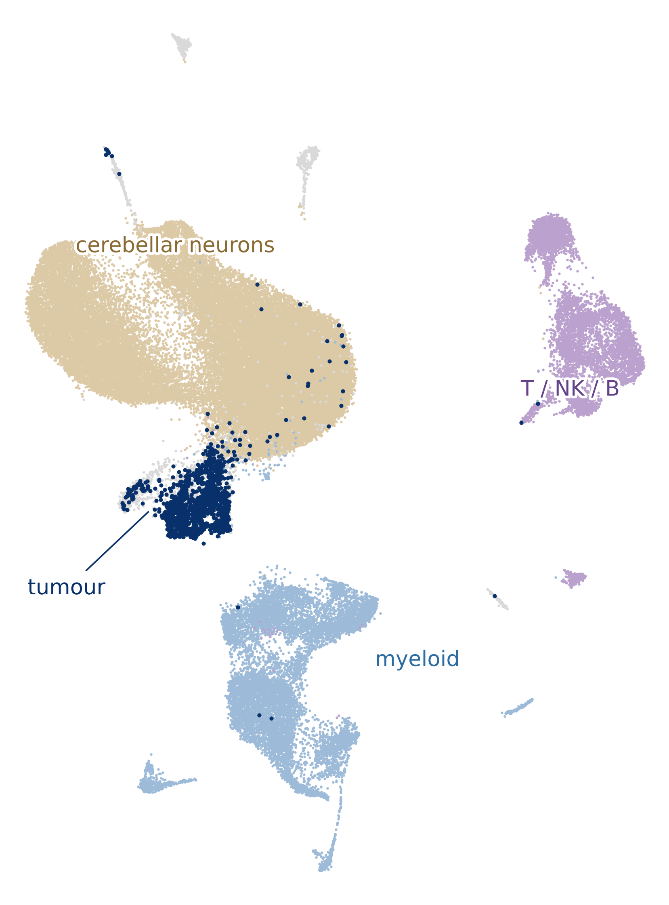

# Mouse DMG model vs. the human DMG atlas

Compares a mouse diffuse midline glioma (DMG) model (15 mice: Control, FUS, RT, FUS+RT) with the human
H3 K27-altered DMG atlas (311,618 cells, 57 samples, 6 studies).

<p align="center"></p>

All 67,313 cells from 15 mice, on the depositors' own UMAP coordinates, coloured by the compartments established
here. Dark navy marks the 1,479 cells carrying the shared copy-number clone — the defensible tumour compartment,
against the 46,532 cells (69 %) the deposited annotation called tumour. The 42,914 cerebellar neurons were
deposited as two "tumour" clusters; grey is the remaining 3,134 astrocyte, vascular, fibroblast and epithelial
cells.

It asks two questions:

1. **Recapitulation:** do the mouse tumour cells reproduce the human malignant states and metaprograms, and does
   the mouse microenvironment resemble the human one?
2. **Treatment effects:** how do focused ultrasound (FUS), radiotherapy (RT) and FUS+RT shift tumour-cell
   states, pathways and immune composition relative to untreated controls?

📄 Results are in [`docs/REPORT.md`](docs/REPORT.md).

## Running

Requires a sibling [`dmg_atlas`](../dmg_atlas) checkout (or set `DMG_ATLAS_ROOT`). Run the numbered scripts
in order:

```bash
python scripts/m01_ingest.py      # … through m16; add --force to recompute an output
```
