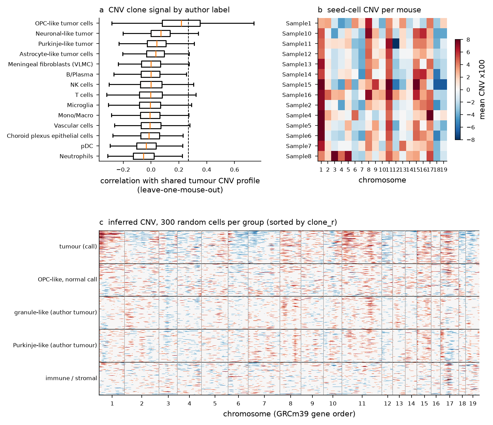
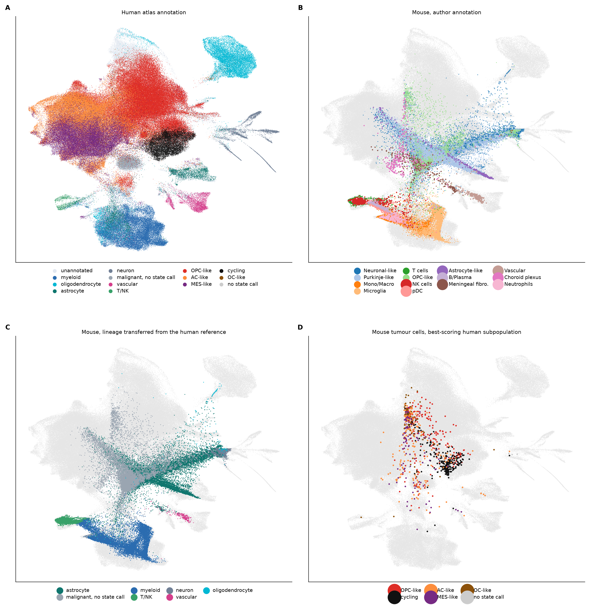
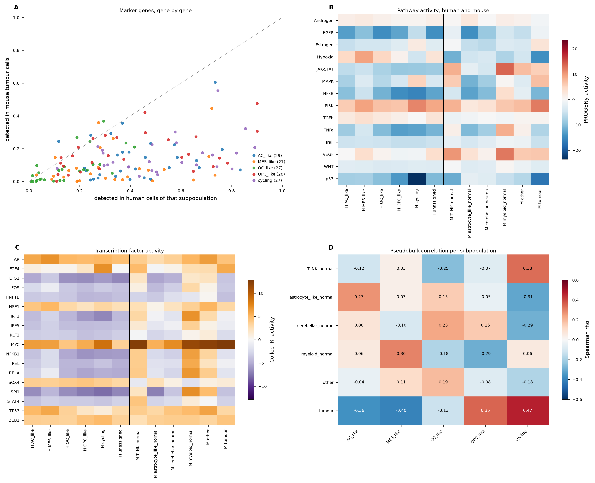
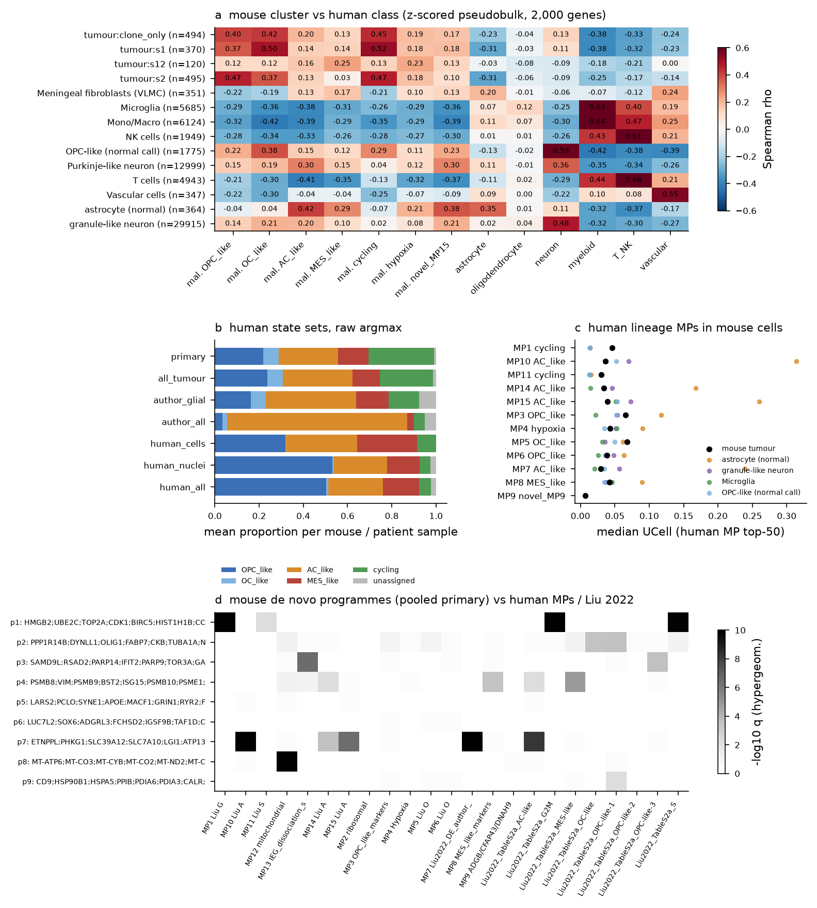
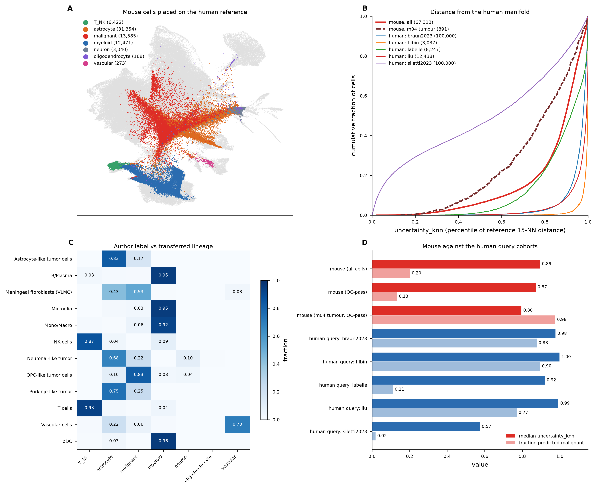
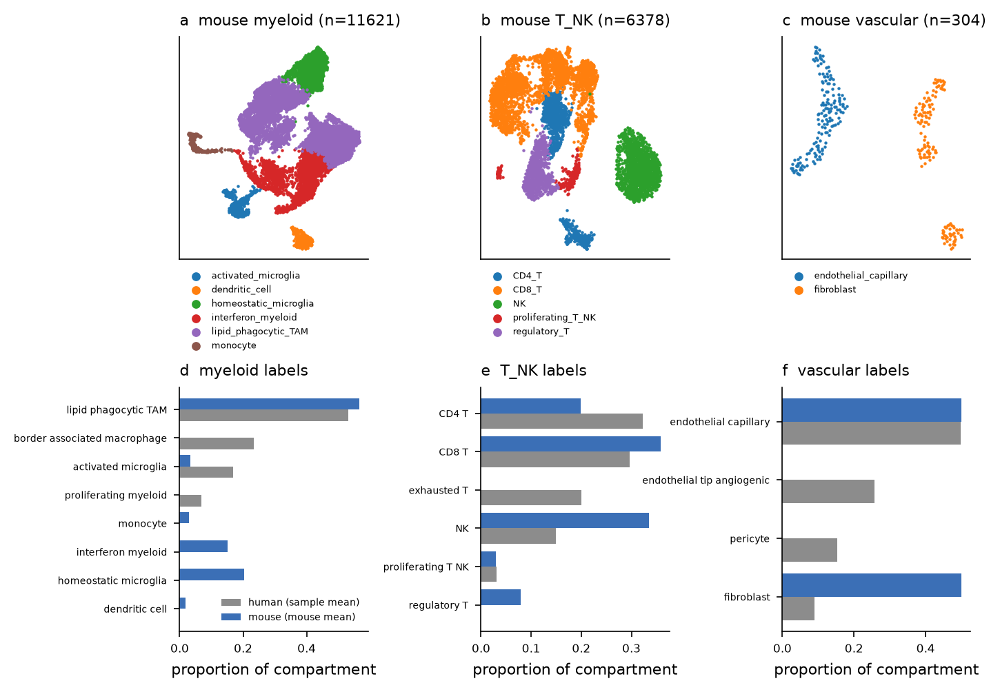
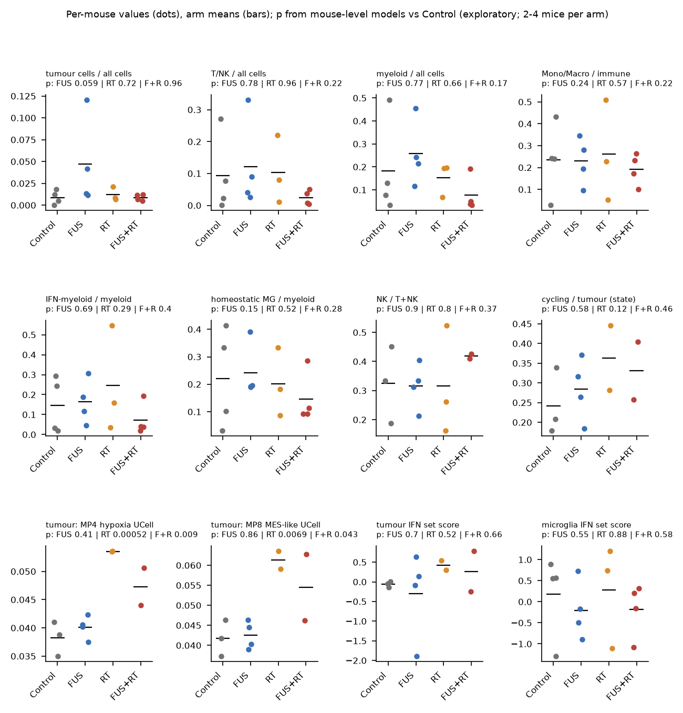
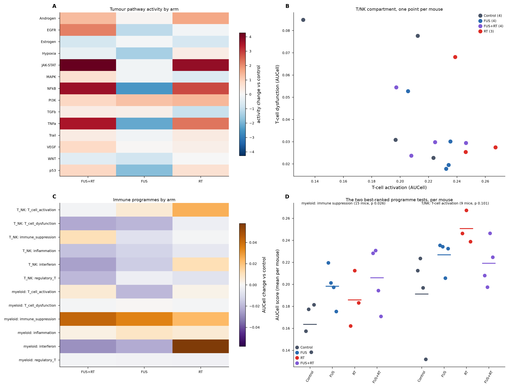

# Mouse DMG model against the human H3 K27-altered DMG atlas

Analysis report, updated 23 October 2026. Code, tables and figures: `mouse_comparison/` (steps `m01`-`m10`, notes in
`docs/m01-m08_notes.md`). Human reference: the 311,618-cell cross-cohort DMG atlas (57 samples, 52 patients, 6 studies).

## Data as received

`DIPG1_allcell_raw_counts.h5ad` - **67,313 cells x 15,304 mm10 genes**, raw UMI counts, pre-filtered (>= 200 genes,
scDblFinder singlets), with author annotations carried through unmodified. **15 mice: Control 4, FUS 4, RT 3, FUS+RT 4.**

There is no immune-checkpoint arm in the deposit and Sample3 is absent, so the treatment analysis covers FUS, RT and
FUS+RT only. The deposit is also missing genes that matter downstream: `Ifng`, `Gzma`, `Gzmb`, `Cd69`, `Tbx21`, `Icos`,
`Klrg1`, `Foxp3` and `Ctla4` are not in its 15,304 genes, which limits what can be said about T-cell activation and
regulatory T cells (see question 2).

## Figure guide

Eight figures, in the order the argument runs. Each caption states the one point it makes.

| # | figure | the point |
|---|---|---|
| 1 | `m04_tumour_calls.png` | which mouse cells are really tumour - the author labels overcall it fourfold |
| 2 | `m06a_joint_embedding.png` | the human reference annotation, and the mouse cells on the same axes |
| 3 | `m09_subpopulation_evidence.png` | markers, pathways, TFs and correlation per subpopulation: two of four are present |
| 4 | `m05_state_comparison.png` | state scores, human metaprograms and the mouse's own de novo programmes |
| 5 | `m06_reference_projection.png` | the human model independently confirms the tumour calls, and the projection is calibrated |
| 6 | `m07_tme_comparison.png` | the microenvironment is where mouse and patient differ most |
| 7 | `m08_treatment_effects.png` | treatment: composition, state scores and differential expression |
| 8 | `m10_treatment_programmes.png` | treatment: pathway, TF and immune-programme activity |

## Which mouse cells are really tumour

The starting point, because it changes every number downstream. The author annotation calls 46,532 cells (69 %) tumour.
Inferred CNV finds a single shared clone - gains of chr1, 8, 11, 15/16, 17 and losses of 18 and 7/12 - present in the
seed cells of 13 of 14 mice, as expected for an implanted clonal line. Correlating every cell against the
leave-one-mouse-out clone profile separates **only** the OPC-like cluster (40 % clone-positive); every other label sits
at the 1 % false-positive rate. The granule-like (29,915 cells) and Purkinje-like (12,999) "tumour" clusters are normal
cerebellar neurons: 98 % and 90 % of them fail the human whole-cell mitochondrial rule, and they express canonical
granule (Cbln3 in 42 %, Gabra6, Neurod1) and Purkinje (Pcp2 87 %, Pvalb 85 %, Calb1) programmes.

The defensible tumour set is therefore **1,479 cells, 891 of them QC-pass** - not 46,532. They are unevenly spread:
Sample6 contributes 54 % of them and one mouse has none.

**Figure 1 - which mouse cells carry the tumour clone.** CNV score and clone correlation per author label, the shared
clone profile across mice, and the subclusters that pass the clone-positive threshold. The point to make: tumour
identity here is defined by copy number, not by the submitted label, and the two largest "tumour" clusters fail it.

## The human reference: four malignant subpopulations

Every mouse result below is judged against this panel, computed from the 167,012 malignant cells of the human atlas
(`results/tables/m06a_human_subpopulations.csv`). Shares are given under both assignment rules because they differ
substantially: `state_raw` is the argmax of the raw marker scores, `state` the argmax of within-assay-class z-scores
(the rule the atlas uses, which forces each sample to spread across states).

| subpopulation | marker genes | cells (raw rule) | share | cells (z rule) | share | samples | metaprograms |
|---|---|---|---|---|---|---|---|
| OPC-like | 30 | 84,979 | 50.9 % | 42,685 | 25.6 % | 53 | MP3, MP6 |
| AC-like | 30 | 44,693 | 26.8 % | 34,495 | 20.7 % | 53 | MP7, MP10, MP14, MP15 |
| MES-like | 30 | 25,960 | 15.5 % | 31,861 | 19.1 % | 54 | MP8 |
| cycling | 29 | 9,766 | 5.9 % | 19,558 | 11.7 % | 53 | MP1, MP11 |
| OC-like | 30 | 1,105 | 0.7 % | 29,954 | 17.9 % | 44 | MP5 |

The human atlas is thus dominated by an OPC-like compartment, with AC-like second, a substantial MES-like fraction, a
small cycling fraction and - under the raw rule - very few OC-like cells. MP1 (cycling) and MP4 (hypoxia) are the only
two metaprograms that met the atlas's replication rule.

**Figure 2 - the human annotation first, then the mouse on the same axes.** (a) the human atlas, malignant cells coloured
by subpopulation (warm colours and black) and the microenvironment by lineage (cool colours), so that AC-like tumour is
not confusable with normal astrocyte nor MES-like with oligodendrocyte; (b) mouse cells placed by their 15 nearest
reference neighbours, coloured by the author annotation; (c) the same cells coloured by the lineage the human model
transfers to them; (d) the 891 QC-pass mouse tumour cells coloured by the human subpopulation they score highest for
(OPC-like 230, cycling 285, AC-like 215, MES-like 102, OC-like 49). Human cell counts per subpopulation are in the
table above; mouse counts per author label are in `m06_projection_by_label.csv`. The point to make: panels (a) and (d)
are the direct comparison - the mouse tumour cells land in the OPC-like and cycling territory and not in the AC-like or
MES-like one.

## Question 1 - does the mouse model contain these four subpopulations?

**Two of the five, clearly: OPC-like and cycling. AC-like and MES-like are absent. OC-like is equivocal.** Four
independent lines of evidence agree, computed for both species on the same footing (`m09`); the mouse adds one axis the
human atlas does not have.

| subpopulation | verdict | pseudobulk rho | marker detection (mouse / human) | pathway and TF evidence |
|---|---|---|---|---|
| cycling | **present** | **+0.47** | 0.118 / 0.506 | E2F4 5.72 (human cycling 6.97), MYC 12.81 (8.65); de novo programme p1 = MP1, 25/50 genes |
| OPC-like | **present** | **+0.35** | 0.146 / 0.313, the best of the five | OLIG2 2.76 (human OPC-like 0.14, cycling 2.43), SOX10 1.08 (0.23) |
| OC-like | equivocal | -0.13 | 0.064 / 0.120 | no distinguishing pathway or TF; the human subpopulation is itself tiny under the raw rule (0.7 %) |
| AC-like | **absent** | **-0.36** | 0.084 / 0.397 | every AC-like metaprogram scores 4.9-8.7x higher in normal mouse astrocytes than in tumour |
| MES-like | **absent** | **-0.40** | 0.040 / 0.292, the lowest of the five | PROGENy hypoxia **-14.4** in mouse tumour vs **+9.4** in human MES-like; HIF1A -1.2 vs +3.0 |

Correlations are Spearman over the 2,000 most variable genes of the human subpopulation pseudobulk profiles, mouse
tumour pseudobulk against each human subpopulation (`m09_subpopulation_correlation.csv`). Marker detection is the median
fraction of cells in which a subpopulation's marker genes are detected - mouse tumour cells against the human cells of
that subpopulation; the absolute gap is expected (the human atlas is 88 % nuclei, the mouse whole cells), so read the
ordering within the mouse column, which puts OPC-like and cycling first and MES-like last.

**Figure 3 - four independent lines of evidence per subpopulation.** (a) every marker gene, detection in mouse tumour
cells against the human cells of that subpopulation; (b) PROGENy pathway activity, human subpopulations left of the
line and mouse groups right; (c) CollecTRI transcription-factor activity on the same profiles; (d) per-subpopulation
pseudobulk correlation. The point to make: all four panels separate OPC-like and cycling from AC-like and MES-like, and
panel (b) shows why - the hypoxia axis that defines human MES-like runs the opposite way in mouse.

**Transcription-factor activity (CollecTRI, 1,185 TFs) supports the same split.** The oligodendroglial-lineage TFs are
recovered in mouse (OLIG2 2.76, SOX10 1.08, both above every human subpopulation) and so is the proliferative module
(E2F4 5.72, MYC 12.81, E2F1 1.67, FOXM1 0.76). The hypoxic regulator HIF1A is negative in mouse (-1.2) where human
MES-like is positive (+3.0). Two stem/progenitor TFs run the other way: ASCL1 (-0.27) and SOX2 (-0.38) are negative in
mouse tumour cells while positive in all four human subpopulations (0.5-1.9 and 1.3-2.0) - a real difference in the
progenitor programme, not only a missing state.

**The mouse's extra axis is interferon/JAK-STAT.** PROGENy JAK-STAT activity is +5.5 in mouse tumour cells against
-5.1 to -9.0 in every human subpopulation, and STAT1 TF activity is +1.6, above every human subpopulation (which span -3.3 for OPC-like to +0.5 for MES-like). This matches the de novo
interferon/MHC-I programmes (p3, p4) and the s12 subcluster from `m05`, and it has no human malignant counterpart.

**On `m05` panel d - yes, p1-p9 are factorised from tumour cells only.** The cNMF runs use the primary tumour set
(`tumour_call == 'tumour'` and QC-pass, 891 cells) and nothing else, so the comparison with the human metaprograms and
the Liu 2022 sets - also tumour-derived - is like for like. The caveat is that technical programmes (p5 neuronal
ambient, p6 nuclear, p8 mitochondrial) still arise *within* those tumour cells, which is what ambient contamination in a
891-cell set looks like.

**Figure 4 - state scores, human metaprograms and the mouse's own programmes.** Human state scores on mouse tumour
cells, metaprogram scores in tumour against each normal mouse population, and the de novo cNMF programmes with their
overlap against the human metaprograms and the Liu 2022 sets. The point to make: the cycling programme is recovered
de novo (p1, 25 of 50 genes with MP1), but every AC-like metaprogram scores higher in normal mouse astrocytes than in
tumour - the apparent AC-like signal is contamination, not a state.

### Independent corroboration: the human reference model applied to the mouse cells

Projecting the mouse cells onto the human reference scANVI zero-shot (`m06`, reference weights verified unchanged: 34
encoder/classifier tensors, max |difference| = 0.0; 2,363 of the 3,000 reference genes have a one-to-one ortholog, 637
zero-filled) corroborates the CNV-based tumour calls by a route that shares none of their assumptions:

- **97.5 % of the 891 QC-pass tumour cells are predicted malignant** at median posterior 0.9986, against **9.9 % of the
  21,859 QC-pass cells called normal**. The author's `OPC-like tumor cells` label is 82.5 % malignant.
- The granule- and Purkinje-like author "tumour" labels map to astrocyte (67.8 % and 75.1 %) at median posteriors 0.73
  and 0.90. Their classifier/neighbour agreement, 0.829 and 0.737, is the lowest of any label above 1,000 cells; across
  all 14 labels only Neutrophils is lower (250 cells, agreement 0.680, posterior 0.541), the human atlas having no
  neutrophil class either.
- Positive controls transfer as expected: Microglia to myeloid 95.2 %, T cells to T/NK 93.0 %, NK to T/NK 86.6 %,
  Vascular to vascular 70.0 %.
- **Calibration against the five human query cohorts that used this identical code path.** Median `uncertainty_knn` -
  the percentile of a cell's mean 15-nearest-neighbour distance within the reference's own distribution - is **0.795 for
  the mouse tumour cells**, against 0.998 (Filbin), 0.992 (Liu), 0.920 (LaBelle), 0.977 (Braun, fetal brain) and 0.574
  (Siletti, adult brain). The mouse cells therefore sit closer to the human manifold than **all three published human
  DMG cohorts** and than the fetal-brain reference; only the adult-brain reference is closer, because its neurons and
  oligodendrocytes land in dense normal-brain regions. The statistic tracks assay and platform more than species.
- What the projection cannot do: 31,354 of 67,313 cells (46.6 %) are assigned `astrocyte`, mostly those cerebellar
  neurons. Roughly half the mouse object has no counterpart class in a reference built from human pons and thalamus, and
  a classifier always returns a label - so read the posterior and `uncertainty_knn` columns, never the label alone.

**Figure 5 - the human reference model applied to the mouse cells.** (a) mouse cells on the human reference embedding,
coloured by transferred lineage; (b) distance from the human manifold, mouse against the five human query cohorts;
(c) author annotation against transferred lineage; (d) the same confidence statistics per cohort. The point to make:
97.5 % of the CNV-defined tumour cells are independently called malignant by a model that never saw them, and panel (b)
shows the mouse cells are no further from the human reference than published human DMG cohorts are.

## The microenvironment: where mouse and patient differ most

Proportions below are per-sample means (each mouse or sample weighted equally); the T/NK share uses the QC-pass
denominator (`m07_celltype_proportions.csv`, rule `sample_mean_qc_pass`).

- **Myeloid (11,621 cells) partly matches.** Lipid-phagocytic TAM are 56.5 % of mouse myeloid against 53.1 % in human.
  But homeostatic microglia are 20.3 % of mouse myeloid and absent from the human atlas, interferon-high myeloid 15.2 %
  and likewise absent, while the human border-associated (23.3 %) and proliferating (6.9 %) myeloid populations have no
  mouse counterpart.
- **T/NK cells are far more abundant than in patients**: 18.9 % of QC-pass mouse cells against 2.1-10.4 % in human
  (depending on assay class). Within the compartment, NK cells are 33.5 % in mouse against 14.9 % in human, and
  regulatory T cells are 7.9 % with no human counterpart label. The human `exhausted_T` population (20.0 %) has no mouse
  equivalent under the margin rule, although a Lag3+/Pdcd1+ cluster of 1,208 cells across 7 mice is its closest match.
- **Whole-tissue composition is dominated by sampling, not biology**: mouse tissue is 68 % neurons and has essentially no
  oligodendrocytes (the human atlas has 24.6 %) and almost no astrocytes (0.7 % against 14.3 %).

**Figure 6 - microenvironment, mouse against patient.** Compartment composition, subcluster labels under the human
labelling rule, and cross-species marker overlap. The point to make: the immune compartment of this model is not the
immune compartment of the disease - it is more inflamed, NK-rich and microglia-rich, and it lacks the
border-associated and proliferating myeloid populations seen in patients.

## Question 2 - how do FUS, RT and FUS+RT affect tumour states and the microenvironment?

**Nothing survives multiple-testing correction in any of the new analyses.** The unit is the mouse throughout; tumour
analyses use the 11 mice with >= 20 QC-pass tumour cells (Control 3, FUS 4, RT 2, FUS+RT 2), immune analyses every mouse
with >= 50 cells in the compartment (myeloid 15 mice, T/NK 9).

| analysis | tests | lowest q | best nominal result |
|---|---|---|---|
| tumour pathway + TF activity (`m10`) | 222 | 0.228 | Androgen pathway up with RT (+1.65, p 0.005); NR3C1 TF up with FUS+RT (+1.86, p 0.004) |
| immune programmes (`m10`) | 36 | 0.459 | myeloid immune suppression up with FUS+RT (+0.042 on a control mean of 0.164, p 0.026) |
| immune gene-level DE (`m10`) | 82,632 | 0.568 | `Il1a` down with RT in myeloid (p 0.013); `Trem2` up with FUS+RT in T/NK (p 0.027) |
| composition, state scores, DE (`m08`) | 320 + 528 | 0.006 | human MP4 hypoxia up with RT (q 0.006), MP8 MES-like (q 0.041) |

Composition itself is flat under the primary model: of its 160 contrasts exactly one reaches q < 0.1 (OC-like state
share, FUS+RT vs RT, q = 0.0986, on 2 versus 2 mice). **Refitting the same 160 contrasts with the inferred processing
block as a covariate yields 9 rows at q < 0.1** - regulatory T cells up in every arm (FUS q 0.047, RT q 0.03),
monocytes up with FUS (q 0.02), pDC/DC down. Because the block was never recorded and is inferred from sample
numbering, neither model is clearly the right one, and that disagreement is itself the finding: with this design,
whether treatment appears to move composition depends on how batch is handled.

**Figure 7 - treatment effects on composition, state scores and expression.** Per-arm composition of tumour states and
immune compartments, the state and metaprogram score contrasts, and the pseudobulk differential-expression summary. The
point to make: this is the figure behind the one nominally significant tumour-state result (MP4 hypoxia with RT), which
Figure 8 then fails to reproduce with an independent pathway method.

**The one previously "consistent" signal does not replicate under an independent method.** `m08` found the human MP4
hypoxia gene set rising with RT (q = 0.006) and MP8 MES-like (q = 0.041). Running PROGENy on the same tumour cells of
the same 11 mice gives **no hypoxia effect whatsoever: +0.31, p = 0.877**. The two readouts disagree, so the RT to
hypoxia/MES shift rests on one gene-set method, in two RT mice, and should be treated as a hypothesis rather than the
study's finding.

**Immune programmes.** Scored with AUCell inside each compartment, using mouse-nomenclature marker sets listed in
`m10_treatment_programmes.py` and their coverage in `m10_programme_coverage.csv`:

- **myeloid immune suppression rises in every treated arm** - FUS+RT +0.042 (p 0.026), FUS +0.035 (p 0.058),
  RT +0.022 (p 0.235), on a control mean of 0.164. Consistent in direction across the three arms, not significant after
  correction over 36 tests. Nominal gene-level movers in the same direction: `Nt5e` up with FUS (p 0.041) and `Trem2` up
  with FUS+RT in T/NK (p 0.027), against `Mrc1` down with FUS+RT (p 0.049).
- **T-cell activation rises with RT** (+0.025 on a control mean of 0.218, p 0.101, 9 mice) while T-cell dysfunction does
  not move - but this programme retains only 7 of its 14 genes, lacking `Ifng`, `Gzma`, `Gzmb`, `Cd69`, `Tbx21`, `Icos`
  and `Klrg1`, so it is under-measured.
- **Inflammation falls with FUS+RT in T/NK** (-0.018 on 0.036, p 0.109), with `Il1b` down (p 0.079) and myeloid `Il1a`
  down with RT (p 0.013) and `Nfkb1` down with FUS+RT (p 0.051).
- **Regulatory T cells cannot be assessed**: `Foxp3`, `Ctla4` and `Tnfrsf4` are all absent from the deposit, leaving a
  three-gene programme. The `m08` observation that regulatory T cells rise in every arm came from marker-label
  clustering under the block-adjusted model, not from `Foxp3`, and is not confirmed here.
- **Interferon is the most variable programme between mice** - the three RT animals score 0.53, 0.38 and 0.14 on a control
  mean of 0.29 - which is why no arm-level test approaches significance despite the large apparent differences in
  figure 8 panel (a).

**Figure 8 - treatment effects on pathways, TFs and immune programmes.** (a) tumour pathway activity by arm, stars mark
q < 0.1 (there are none); (b) T-cell activation against dysfunction, one point per mouse; (c) immune programmes by arm;
(d) the two best-ranked programme tests with their per-mouse values. The point to make: the apparent blocks of colour in
(a) and (c) are not significant at this sample size, and panel (d) shows why - the per-mouse spread within an arm is as
large as the difference between arms.

## What this analysis cannot support

1. **Power.** Two to four mice per arm, and the tumour analyses rest on 11 mice of which only 2 are RT and 2 FUS+RT.
   Across 222 pathway/TF tests, 36 programme tests and 82,632 gene tests, nothing reaches q < 0.1; the lowest q in the
   gene-level analysis is 0.568. These are hypotheses.
2. **Tumour-cell yield.** 891 QC-pass tumour cells for the whole experiment, 45 % of them from one mouse (Sample6); one
   mouse has none. Any per-arm tumour statistic rests on tens of cells per animal.
3. **Tissue sampling.** The immune fraction swings 5-77 % between mice and cerebellar neurons reach ~80 %; this
   dominates composition. Dissection consistency matters more here than any treatment.
4. **Batch.** The processing block is inferred from sample numbering because it was not recorded, so treatment and batch
   cannot be separated with confidence.
5. **Checkpoint blockade** is unassessed - the data are not in the deposit.
6. **Missing genes.** Beyond the ortholog restriction (12,759 one-to-one orthologs; 78.8 % of the reference's 3,000
   selected genes; MP9 only 44 % covered), the deposit itself lacks `Ifng`, `Gzmb`, `Foxp3` and `Ctla4`, which caps what
   the activation and regulatory-T readouts can show.
7. **Cross-species resources.** CollecTRI and PROGENy are human; they are applied to the ortholog-mapped mouse matrix so
   that both species are scored with identical weights, but mouse-specific regulation is invisible to them by
   construction, and per-TF target coverage is reduced (reported as `n_targets_shared`).

## What would make the comparison conclusive

- the ICI arm, and Sample3;
- the recorded processing batch and dissection protocol per mouse;
- tumour-cell enrichment (sorting, or dissecting the lesion rather than including cerebellum) - the current yield is the
  binding constraint, ahead of mouse numbers;
- more mice in the RT and FUS+RT arms specifically, since that is where the candidate effects sit;
- an unfiltered gene matrix, so that `Ifng`, `Gzmb`, `Foxp3` and `Ctla4` can be used.

## How these findings sit against the literature

Searched via PubMed (NCBI); every reference below was retrieved and its metadata verified there, and DOIs are given.

**What agrees.**

- *The OPC/OC-lineage, proliferative identity is the expected one.* Human H3K27M glioma is built on a stem-like,
  OPC-like compartment that supplies a smaller cycling fraction and more differentiated progeny — Filbin et al. 2018,
  *Science* (PMID 29674595, doi 10.1126/science.aao4750); Liu et al. 2022, *Nat Genet* (36471067,
  10.1038/s41588-022-01236-3); Jessa et al. 2022, *Nat Genet* (36471070, 10.1038/s41588-022-01205-w); Harpaz et al. 2022,
  *Mol Cell* (35716669, 10.1016/j.molcel.2022.05.023). Our mouse tumour cells correlating best with the human OC-like,
  OPC-like and cycling classes, and recovering the human cycling programme de novo, is the result these papers predict.
- *So does the model's cell of origin.* Mouse DMG models initiated in oligodendrocyte-progenitor lineages reproduce an
  OPC-like tumour identity — Tomita et al. 2022, *Glia* (35524725, 10.1002/glia.24189); Misuraca et al. 2016, *Neoplasia*
  (26806352, 10.1016/j.neo.2015.12.002); and for immunocompetent pediatric DMG allografts, du Chatinier et al. 2022,
  *Neuro-Oncol Adv* (35733514, 10.1093/noajnl/vdac079).
- *The excess of T and NK cells is a known model-versus-patient divergence, not a finding about DMG biology.* Human DIPG
  is characterised as a non-inflammatory, T-cell-poor microenvironment — Lin et al. 2018, *Acta Neuropathol Commun*
  (29954445, 10.1186/s40478-018-0553-x). Our 19 % T/NK against 2–10 % in human therefore reads as the implanted,
  immunocompetent model being more inflamed than the disease it models.
- *The myeloid mismatch is documented across species.* Myeloid composition in glioblastoma differs systematically between
  mouse models and patients, including the microglia-versus-monocyte balance we see (homeostatic microglia 20 % of mouse
  myeloid against 0 % in our human atlas) — Pombo Antunes et al. 2021, *Nat Neurosci* (33782623,
  10.1038/s41593-020-00789-y).
- *The interferon / MHC-I axis with no human malignant counterpart has a mechanistic precedent.* Irradiation activates
  tumour-cell-intrinsic cytosolic DNA sensing and type I interferon — Deng et al. 2014, *Immunity* (25517616,
  10.1016/j.immuni.2014.10.019); Vanpouille-Box et al. 2017, *Nat Commun* (28598415, 10.1038/ncomms15618). That our
  interferon/MHC-I programme is carried by true tumour cells, prominently in an irradiated animal, fits this directly.
  Note also that hypoxia suppresses IFN-γ-driven MHC-I induction — Murthy et al. 2019, *ImmunoHorizons* (31356176,
  10.4049/immunohorizons.1900017) — which makes the co-occurrence of our RT-associated hypoxia and interferon signals
  worth disentangling rather than reporting as one effect.
- *Therapy-induced state plasticity in DIPG is established in principle.* Huang et al. 2026, *Cancer Lett* (42532370,
  10.1016/j.canlet.2026.218771) report therapy-associated lineage plasticity in DIPG under CDK4/6 inhibition, so a
  treatment shifting tumour-cell state is a reasonable prior for our RT observation.
- *The ambient-RNA reading of the granule- and Purkinje-like clusters is a recognised artefact class*, not an ad-hoc
  dismissal — Young & Behjati 2020, *GigaScience* (33367645, 10.1093/gigascience/giaa151).
- *Focused ultrasound in DIPG is studied as a delivery intervention, not as monotherapy*, which is the context for our
  FUS null — Ishida et al. 2021, *J Control Release* (33188825, 10.1016/j.jconrel.2020.11.010); and for the clinical
  framing, Filieri et al. 2025, *Pharmaceuticals* (40283959).

**What does not agree, or has no precedent to agree with.**

- *The missing AC-like and MES-like axes are a real divergence.* Both are prominent in human H3K27M glioma (Liu et al.
  2022; Filbin et al. 2018), and the mouse reproduces neither — its apparent AC-like signal comes from normal astrocytes.
  Likewise the human atlas has a substantial oligodendrocyte compartment and this model has none. These are the
  model's limits as a surrogate, and they are specific enough to design around.
- *The RT → hypoxia / MES-like shift has no DMG-specific single-cell precedent that I could find.* Proneural-to-mesenchymal
  transition is well described in glioma, but the reports retrieved here are driven by other stimuli — neuronal activity
  (Guo et al. 2024, *Cancer Res*, 37963207, 10.1158/0008-5472.CAN-23-0609), SPI1/MIR222HG (Fan et al. 2023,
  *Theranostics*, 37351164, 10.7150/thno.82590), FOSL1 (Chen et al. 2022, *Mol Ther*, 35351656,
  10.1016/j.ymthe.2021.10.028) — not by irradiation, and not in H3K27M disease. A targeted search for radiation-induced
  state transition in glioma at single-cell resolution returned nothing on point. Our result is therefore consistent with
  the direction of an adjacent literature rather than confirmed by a matching one. It is also **not corroborated within
  this dataset**: PROGENy hypoxia-pathway activity in the same tumour cells shows no RT effect at all (+0.31, p = 0.877,
  m10), so the signal is carried by the human MP4 gene set and not by an independent pathway readout. Given two RT mice,
  that is the standing of a hypothesis worth testing, not of a result.

## Files

| what | where |
|---|---|
| step notes, every number above | `docs/m01-m08_notes.md` |
| tumour calls, CNV clone | `results/tables/m04_*.csv`, `results/figures/m04_tumour_calls.png` |
| state and metaprogram comparison | `results/tables/m05_*.csv*`, `results/figures/m05_state_comparison.png` |
| reference projection and calibration | `results/tables/m06_*.csv*`, `results/figures/m06_reference_projection.png` |
| human subpopulation panel, joint embedding | `results/tables/m06a_*`, `results/figures/m06a_joint_embedding.png` |
| subpopulation evidence: markers, pathways, TFs, correlation | `results/tables/m09_*.csv`, `results/figures/m09_subpopulation_evidence.png` |
| treatment effects on pathways, TFs and immune programmes | `results/tables/m10_*.csv*`, `results/figures/m10_treatment_programmes.png` |
| microenvironment | `results/tables/m07_*.csv`, `results/figures/m07_tme_comparison.png` |
| treatment effects (composition, states, DE) | `results/tables/m08_*.csv*`, `results/figures/m08_treatment_effects.png` |

Every file in `results/` has a `.provenance.json` sidecar recording the producing script and the sha256 of each input.
CollecTRI and PROGENy were retrieved from omnipathdb.org; see `data/external/resources_provenance.json`.
